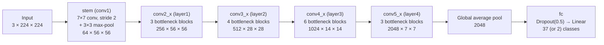
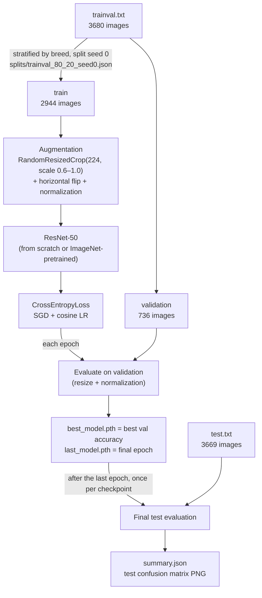
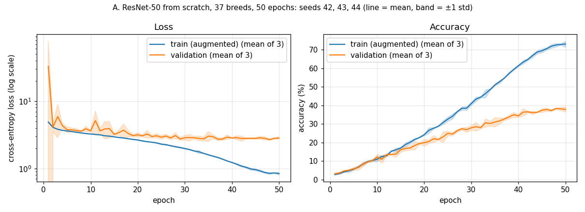
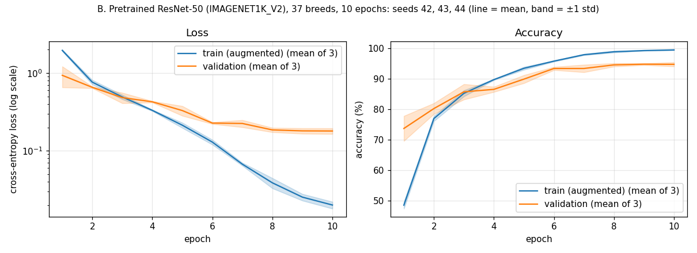
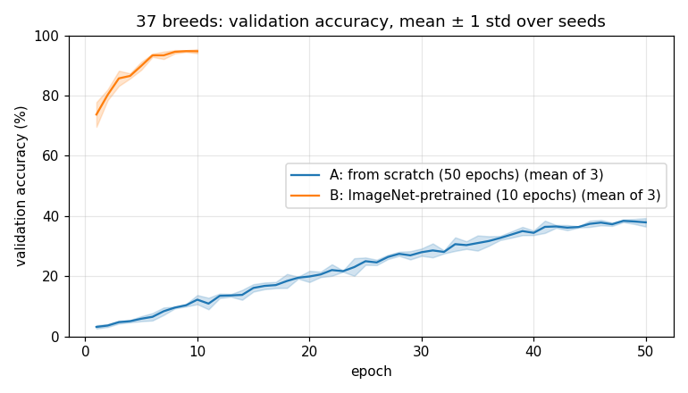
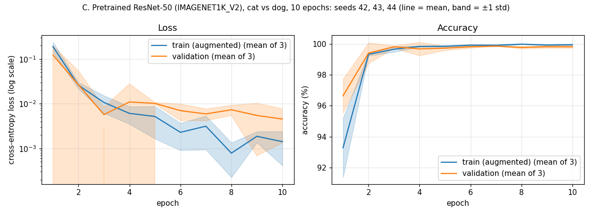
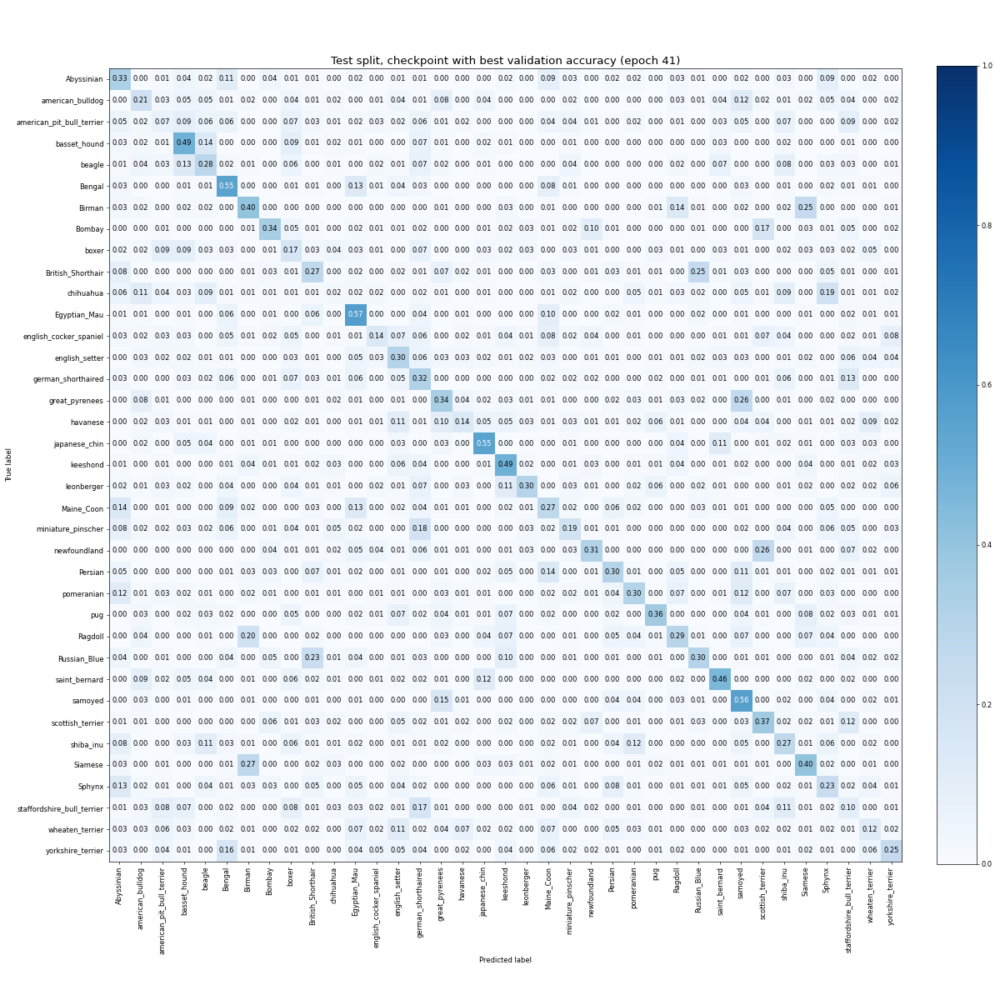
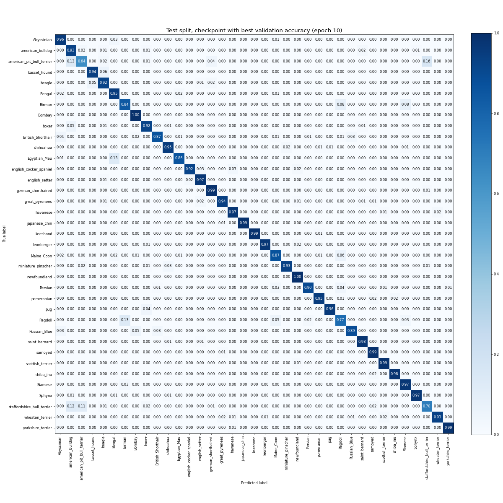
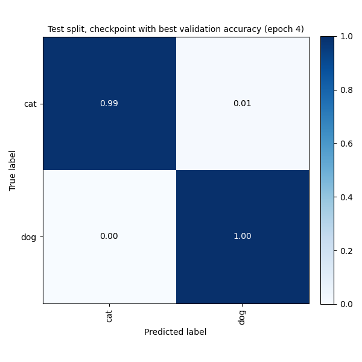

<h1 align="center">ResNet-50 in PyTorch</h1>

<p align="center">
  ResNet-50 for pet breed classification on the Oxford-IIIT Pet dataset: a from-scratch implementation and an ImageNet-pretrained transfer-learning variant.
</p>

<p align="center">
  
  
  
</p>

---

## Table of Contents

- [Overview](#overview)
- [Features](#features)
- [Project Structure](#project-structure)
- [Model Architecture](#model-architecture)
- [Dataset](#dataset)
- [Getting Started](#getting-started)
- [Usage](#usage)
- [Transfer Learning](#transfer-learning)
- [Training Configuration](#training-configuration)
- [Experimental Protocol](#experimental-protocol)
  - [Limitations](#limitations)
- [Results](#results)
  - [How to reproduce](#how-to-reproduce)
- [Project Status](#project-status)
- [License](#license)
- [References](#references)

## Overview
[](https://gitdiagram.com/bzaat/pytorch-resnet50v1-implementation?utm_source=readme&utm_medium=picture)

This project implements the ResNet-50 architecture from scratch in PyTorch and trains it on the [Oxford-IIIT Pet Dataset](https://www.robots.ox.ac.uk/~vgg/data/pets/) (37 cat and dog breeds). It is a learning-oriented codebase focused on three things: understanding CNN architectures, building a clean data pipeline, and setting up a reproducible training workflow.

Two models are included so they can be compared on the same data: a ResNet-50 trained from scratch (`oxiii_pet.model`), and a `torchvision` ResNet-50 pretrained on ImageNet and fine-tuned on the pet dataset (`oxiii_pet.transfer_learning`).

| Model (37 breeds, official test split) | Test accuracy, checkpoint selected on validation | Test accuracy, last epoch |
|----------------------------------------|:------------------:|:-----------:|
| ResNet-50 from scratch, 50 epochs | 31.99 ± 1.13% | 32.25 ± 0.75% |
| Pretrained ResNet-50, fine-tuned, 10 epochs | **92.39 ± 0.27%** | **92.45 ± 0.22%** |

Test accuracy on the official `test.txt` split (3669 images), mean ± sample standard deviation over 3 seeds (42, 43, 44). The checkpoint is selected on a held-out validation split (20% of `trainval.txt`), and the test split is evaluated only once per checkpoint, after training. See [Experimental Protocol](#experimental-protocol), [`results/summary.md`](results/summary.md) and [How to reproduce](#how-to-reproduce).

## Features

- **ResNet-50 from scratch:** bottleneck residual blocks, projection shortcuts, and a configurable classification head, with no dependency on `torchvision.models` (`oxiii_pet/model/models.py`).
- **Transfer learning:** an ImageNet-pretrained `torchvision` ResNet-50 (V1 or V2 weights) with a new classification head; only the head and `layer4` are trained, and the rest of the backbone stays frozen.
- **Custom `Dataset`:** reads the official annotation files, builds image paths, converts labels to zero-based indices, and loads images as RGB with Pillow.
- **Train / validation / test splits:** a fixed, stratified 80/20 split of the official `trainval.txt` into train and validation (`splits/trainval_80_20_seed0.json`), and the official `test.txt` as a held-out test set used once per run.
- **Two task modes:** 37-breed classification (default) or binary cat-vs-dog classification, selected with `--num_class`.
- **Training script with CLI:** configurable epochs, batch size, data directory and log directory.
- **Experiment tracking:** every run gets its own folder (`runs/<date>_<experiment>/`) with a `train.log`, a `metrics.csv` (one row per epoch), a `config.json` (all arguments, seed, library versions, GPU and git commit), a `summary.json` (validation and final test metrics), the test confusion matrix of the selected checkpoint as a PNG, and TensorBoard logs (train/validation loss and accuracy, learning rate, per-epoch validation confusion matrix). tqdm shows loss, accuracy and learning rate live.
- **Reproducibility:** seeds for Python, NumPy, PyTorch and the DataLoader (`--seed`, default 42), recorded in `config.json`; a fixed data split that does not depend on the training seed; `scripts/run_experiments.sh` re-runs every reported experiment.
- **Checkpointing and resume:** `last_model.pth` (final epoch) and `best_model.pth` (best validation accuracy) are saved for both models; the from-scratch run can be resumed.
- **Inference script:** classify one image or a whole folder with the same preprocessing as evaluation, printing the top-3 breeds.
- **CPU and GPU support:** training and evaluation run on CUDA when available and fall back to the CPU otherwise.
- **Installable package managed with [uv](https://docs.astral.sh/uv/):** `uv sync` installs the locked dependencies and the project in editable mode, so `oxiii_pet` is importable from anywhere.

## Project Structure

```text
.
├── LICENSE
├── pyproject.toml
├── uv.lock
├── splits/
│   └── trainval_80_20_seed0.json         # fixed train/validation image lists (stratified, split seed 0)
├── scripts/
│   └── run_experiments.sh                # runs experiments A, B, C for seeds 42, 43, 44
├── results/                              # summary.md, plots, per-seed logs/metrics; legacy_test_selected/ = superseded runs
└── src/
    └── oxiii_pet/
        ├── dataset/
        │   ├── dataset_oxiiit_pet.py     # OxfordData: custom Dataset (split = train / val / test)
        │   ├── make_split.py             # creates the stratified train/validation split
        │   └── dataloader_oxiii_pet.py   # DataLoader smoke test
        ├── model/                        # ResNet-50 from scratch
        │   ├── models.py                 # Bottleneck block and Resnet50
        │   ├── train.py                  # Training and evaluation entry point
        │   └── test.py                   # Inference on an image or a folder
        ├── transfer_learning/            # Pretrained ResNet-50 fine-tuning
        │   ├── transfer_learning.py      # MyModel: pretrained backbone + new head
        │   ├── train.py                  # Fine-tuning and evaluation entry point
        │   └── test.py                   # Inference on an image or a folder
        └── utils/
            ├── run_utils.py              # Seeding, run folder, logging, metrics.csv, train/eval loop, final test
            ├── inference.py              # Shared preprocessing and checkpoint loading for test.py
            ├── plot_metrics.py           # Train vs validation curves from metrics.csv (one run or mean ± std)
            ├── aggregate_results.py      # Collects multi-seed runs into results/ (tables and plots)
            └── export_tb_images.py       # Export a TensorBoard image (confusion matrix) to PNG
```

## Model Architecture

The network follows the standard ResNet-50 layout: a convolutional stem, four stages of bottleneck blocks (3-4-6-3), and a global-pooling classification head. Shapes below assume a 224 × 224 input.

| Stage | Block (1×1 → 3×3 → 1×1) | Repeats | Output channels | Output size |
|-------|-------------------------|:-------:|:---------------:|:-----------:|
| `stem` | 7×7 conv (stride 2) + 3×3 max-pool (stride 2) | 1 | 64 | 56 × 56 |
| `conv2_x` | 64 → 64 → 256 | 3 | 256 | 56 × 56 |
| `conv3_x` | 128 → 128 → 512 | 4 | 512 | 28 × 28 |
| `conv4_x` | 256 → 256 → 1024 | 6 | 1024 | 14 × 14 |
| `conv5_x` | 512 → 512 → 2048 | 3 | 2048 | 7 × 7 |
| `fc` | AdaptiveAvgPool → Flatten → Dropout(0.5) → Linear | 1 | 37 | – |



The names follow the from-scratch model in `models.py`; the names in parentheses are the equivalent modules of `torchvision.models.resnet50`, which the transfer-learning model uses. The transfer-learning model replaces `fc` with a larger head (see [Transfer Learning](#transfer-learning)).

Each bottleneck block uses a residual (identity) connection. A 1×1 projection shortcut is applied whenever the spatial size or channel count changes. Downsampling is done by the stride of the 3×3 convolution.

## Dataset

The project uses the [Oxford-IIIT Pet Dataset](https://www.robots.ox.ac.uk/~vgg/data/pets/): roughly 7,400 images of 37 cat and dog breeds.

Each line of an annotation file has the format:

```text
<image_name> <class_id> <species> <breed_id>
```

Expected directory structure (the dataset root defaults to `data/`):

```text
data/
├── annotations/
│   ├── trainval.txt
│   └── test.txt
└── images/
    ├── Abyssinian_1.jpg
    ├── Abyssinian_2.jpg
    └── ...
```

### Data pipeline

The `OxfordData` class (`src/oxiii_pet/dataset/dataset_oxiiit_pet.py`) inherits from `torch.utils.data.Dataset`:

1. **Load annotations:** `split="test"` reads `test.txt`. `split="train"` and `split="val"` read `trainval.txt` and keep only the images listed for that part in the split file (`--split_file`, default `splits/trainval_80_20_seed0.json`).
2. **Select the label column:** keeps the image name plus one label column, chosen by `num_class`: the breed class ID for 37 classes, or the species (cat/dog) for 2 classes. Any other value is rejected.
3. **Build paths:** joins `root/images/<image_name>.jpg`.
4. **Map labels:** converts 1-based class IDs to 0-based indices (`label - 1`).
5. **Load images:** opens each image with Pillow and converts it to RGB.
6. **Transform:** applies the optional `transform`.
7. **Return samples:** each item is an `(image, label)` pair.

The split file is committed, so no step is needed. To recreate it (the result is identical for the same split seed):

```bash
uv run python -m oxiii_pet.dataset.make_split     # --val_fraction 0.2 --split_seed 0
```

## Getting Started

### Prerequisites

- [uv](https://docs.astral.sh/uv/getting-started/installation/) (it can also download a suitable Python for you)
- Python 3.10 or newer
- (Optional) An NVIDIA GPU with CUDA for faster training

### Installation

```bash
# 1. Install uv (once)
curl -LsSf https://astral.sh/uv/install.sh | sh     # Windows (PowerShell): powershell -c "irm https://astral.sh/uv/install.ps1 | iex"

# 2. Clone the repository
git clone https://github.com/bzaat/pytorch-resnet50v1-implementation.git
cd pytorch-resnet50v1-implementation

# 3. Create .venv and install the locked dependencies and the project (editable)
uv sync
```

`uv sync` reads `pyproject.toml` and `uv.lock`, creates a `.venv` in the project folder and installs everything into it. There is no need to activate the environment: prefix commands with `uv run` (as in the examples below), or activate `.venv` yourself if you prefer.

> **GPU users:** the default PyPI build of PyTorch on Linux includes CUDA support. For a CPU-only build or a specific CUDA version, follow uv's [PyTorch guide](https://docs.astral.sh/uv/guides/integration/pytorch/).

Verify the installation:

```bash
uv run python -c "import torch; print(torch.__version__, torch.cuda.is_available())"
```

### Download the dataset

```bash
mkdir -p data && cd data

curl -O https://www.robots.ox.ac.uk/~vgg/data/pets/data/images.tar.gz
curl -O https://www.robots.ox.ac.uk/~vgg/data/pets/data/annotations.tar.gz

tar -xzf images.tar.gz
tar -xzf annotations.tar.gz
cd ..
```

By default the code looks for the dataset in `data/`. To use another location, set the `DATA_DIR` environment variable or pass `--dir` to the training script:

```bash
export DATA_DIR=/path/to/oxford-iiit-pet     # Windows (PowerShell): $env:DATA_DIR = "C:\path\to\oxford-iiit-pet"
```

## Usage

### 1. Check the data pipeline

Run the DataLoader smoke test to confirm the dataset is found and batches have the expected shape:

```bash
uv run python -m oxiii_pet.dataset.dataloader_oxiii_pet
```

Or use the dataset directly in Python. The first argument of `OxfordData` is the number of classes: `37` for breeds or `2` for cat vs dog. `split` is `"train"`, `"val"` or `"test"`:

```python
import torch
from torch.utils.data import DataLoader
from torchvision.transforms.v2 import Compose, Resize, ToDtype, ToImage

from oxiii_pet.dataset.dataset_oxiiit_pet import OxfordData

transform = Compose([Resize((224, 224)), ToImage(), ToDtype(torch.float32, scale=True)])

train_set = OxfordData(37, "data", split="train", transform=transform)
loader = DataLoader(train_set, batch_size=16, shuffle=True, num_workers=4, drop_last=True)

images, labels = next(iter(loader))
print(images.shape)   # torch.Size([16, 3, 224, 224])
print(labels.shape)   # torch.Size([16])
```

### 2. Train the model

```bash
uv run python -m oxiii_pet.model.train --epochs 50 --batch_size 32 --dir data
```

| Argument | Short | Default | Description |
|----------|:-----:|---------|-------------|
| `--epochs` | `-e` | `10` | Number of training epochs |
| `--batch_size` | `-b` | `8` | Batch size for all splits |
| `--images_size` | `-i` | `224` | Input image size |
| `--dir` | `-d` | `$DATA_DIR` or `data` | Dataset root directory |
| `--run_dir` | `-r` | `runs/<date>_scratch_<n>cls` | Run folder for `train.log`, `metrics.csv`, `config.json`, `summary.json` |
| `--logging` | `-l` | `<run_dir>/tensorboard` | Directory for TensorBoard logs |
| `--trained_model` | `-t` | `<run_dir>/checkpoints` | Directory where checkpoints are saved |
| `--checkpoint` | `-c` | none | Checkpoint to resume training from |
| `--num_class` | `-n` | `37` | Number of classes: `37` for breeds, `2` for cat vs dog |
| `--clip` | `-cl` | `0` | Gradient-norm clipping threshold; `0` disables clipping |
| `--seed` | `-s` | `42` | Random seed |
| `--num_workers` | `-w` | `4` | DataLoader worker processes |
| `--split_file` | | `splits/trainval_80_20_seed0.json` | Train/validation image lists |

After every epoch the model is evaluated on the validation split. Two checkpoints are written: `last_model.pth` after every epoch, and `best_model.pth` whenever validation accuracy strictly improves (on a tie the earlier epoch is kept). Each checkpoint stores the epoch, model, optimizer, scheduler and RNG state, the best validation accuracy and epoch, and the class names. After the last epoch, both checkpoints are evaluated once on the test split; the results go to `summary.json` and `train.log`, and the test confusion matrix of `best_model.pth` is saved as `test_confusion_matrix_best_val.png` in the run folder.

To resume an interrupted run, pass the checkpoint and the same `--run_dir` and `--epochs` so the learning-rate schedule stays consistent and `metrics.csv` keeps growing. Checkpoints also store the random-number state, so a resumed run continues with new data orders and augmentations instead of replaying epoch 1. The final test evaluation runs when the resumed run finishes:

```bash
uv run python -m oxiii_pet.model.train --epochs 50 --batch_size 32 \
    --run_dir runs/<run> --checkpoint runs/<run>/checkpoints/last_model.pth
```

To train the binary cat-vs-dog task instead of the 37 breeds, pass `--num_class 2`:

```bash
uv run python -m oxiii_pet.model.train --epochs 50 --batch_size 32 --num_class 2
```

### 3. Monitor training

```bash
uv run tensorboard --logdir runs/
```

Logged scalars: `Train/Loss` (per iteration), `Train/EpochLoss`, `Train/Accuracy`, `Validation/Loss`, `Validation/Accuracy`, `LR`. "Validation" is the held-out 20% of `trainval.txt`; nothing from the test split is logged per epoch.

Logged images: `Validation/confusion_matrix`, the confusion matrix of the validation split with breed names on the axes, written once per epoch by `plot_confusion_matrix` in `utils/run_utils.py` (scikit-learn computes the matrix and matplotlib draws it). Open the **Images** tab and drag the slider to see how the errors change during training. Rows are the true classes and columns are the predicted classes; each cell shows the fraction of that true class predicted as the column class, so the diagonal is the per-class recall.

### 4. Classify images

Both `test.py` scripts apply the evaluation preprocessing (resize to 224 × 224, ImageNet mean/std normalization) and print the top-3 classes for one image or every image in a folder. Class names are read from the checkpoint (or from the dataset annotations for older checkpoints), in the dataset's label order.

```bash
# From-scratch model; -c takes a .pth file or a run folder (default: newest runs/*scratch*/checkpoints/best_model.pth)
uv run python -m oxiii_pet.model.test -c runs/<run> -t test_images

# Transfer-learning model (default: newest runs/*transfer*/checkpoints/best_model.pth); add -n 2 for cat vs dog
uv run python -m oxiii_pet.transfer_learning.test -c runs/<run> -t test_images/1.jpg
```

| Argument | Short | Default | Description |
|----------|:-----:|---------|-------------|
| `--checkpoint` | `-c` | newest best checkpoint under `runs/` | `.pth` file or run folder |
| `--test_path` | `-t` | `test_images` | Image file or folder |
| `--num_class` | `-n` | `37` | Must match the checkpoint |
| `--images_size` | `-i` | `224` | Input image size |
| `--data_dir` | `-d` | `$DATA_DIR` or `data` | Only used for class names if the checkpoint has none |
| `--version` | `-v` | `2` | Transfer-learning test only: ImageNet weights version of the backbone |

### 5. Load a trained checkpoint in Python

```python
import torch
from oxiii_pet.model.models import Resnet50

model = Resnet50(num_classes=37)  # use 2 if you trained with --num_class 2
checkpoint = torch.load("runs/<run>/checkpoints/best_model.pth", map_location="cpu")
model.load_state_dict(checkpoint["model"])
model.eval()

print(f"Loaded checkpoint from epoch {checkpoint['epoch']}")
```

## Transfer Learning

`oxiii_pet.transfer_learning` fine-tunes a `torchvision` ResNet-50 that was pretrained on ImageNet-1K, using the same data pipeline, transforms and optimizer settings as the from-scratch model.

**Design** (`transfer_learning/transfer_learning.py`)

| Part | Setting |
|------|---------|
| Backbone | `torchvision.models.resnet50` with `IMAGENET1K_V2` weights (default) or `IMAGENET1K_V1` (`--version 1`) |
| Head | the original `fc` is removed and replaced by `Dropout(0.5)` → `Linear(2048, 1024)` → `ReLU` → `Linear(1024, num_classes)` |
| Trainable | the new head and `layer4`; the stem and `layer1`–`layer3` are frozen (`requires_grad=False`) |
| BatchNorm | `MyModel.train()` keeps the whole pretrained backbone, including `layer4`, in eval mode, so its BatchNorm layers keep using the ImageNet running statistics instead of re-estimating them from batches of the pet data; only their scale and shift are trained in `layer4` |

Freezing parameters with `requires_grad=False` does not stop BatchNorm from updating its running mean and variance, because those are buffers updated in the forward pass whenever the layer is in train mode. This is why `train()` is overridden.

**Train**

```bash
uv run python -m oxiii_pet.transfer_learning.train -n 37 --epoch 10 --batch_size 32
```

| Argument | Short | Default | Description |
|----------|:-----:|---------|-------------|
| `--data_path` | `-d` | `$DATA_DIR` or `data` | Dataset root directory |
| `--epoch` | `-e` | `10` | Number of training epochs |
| `--image_size` | `-s` | `224` | Input image size |
| `--num_classes` | `-n` | `37` | Number of classes: `37` for breeds, `2` for cat vs dog |
| `--batch_size` | `-b` | `32` | Batch size for all splits |
| `--version` | `-v` | `2` | ImageNet-1K weights: `1` = V1, `2` = V2 |
| `--run_dir` | `-r` | `runs/<date>_transfer_<n>cls` | Run folder for logs, metrics, config and TensorBoard |
| `--trained_model` | `-t` | `<run_dir>/checkpoints` | Directory for the saved weights (created automatically) |
| `--seed` | | `42` | Random seed |
| `--num_workers` | `-w` | `4` | DataLoader worker processes |
| `--split_file` | | `splits/trainval_80_20_seed0.json` | Train/validation image lists |

Evaluation and checkpoints work as in the from-scratch script: validation after every epoch, `last_model.pth` every epoch, `best_model.pth` on strictly better validation accuracy, and one test evaluation of each checkpoint after the last epoch. Both checkpoints store the model weights, epoch, validation accuracy, class names and weights version. The run folder gets the same `train.log`, `metrics.csv`, `config.json`, `summary.json`, test confusion matrix and TensorBoard logs. Resuming is not supported.

## Training Configuration

| Component | Setting |
|-----------|---------|
| Loss | `CrossEntropyLoss` |
| Optimizer | SGD, learning rate `1e-2`, momentum `0.9`, weight decay `1e-4` |
| LR schedule | `CosineAnnealingLR` over all epochs (`T_max` = number of epochs), stepped once per epoch |
| Weight init | Kaiming normal (convolutions), BatchNorm weight 1 / bias 0, Linear `N(0, 0.01)` |
| Train transforms | `RandomResizedCrop(224, scale=(0.6, 1.0))`, `RandomHorizontalFlip`, ImageNet mean/std normalization |
| Validation/test transforms | `Resize((224, 224))`, ImageNet mean/std normalization |
| DataLoader | 4 workers, `drop_last=True` for training |
| Evaluation | Validation split once per epoch; test split once per checkpoint after training |
| Output classes | 37 breeds by default, or 2 (cat vs dog) with `--num_class 2` |

The transfer-learning script uses the same optimizer, schedule, transforms and DataLoader settings (see [Transfer Learning](#transfer-learning)).

## Experimental Protocol



**Data.** The official Oxford-IIIT Pet splits are used: `trainval.txt` (3680 images) and `test.txt` (3669 images). `trainval.txt` is split once into train (80%, 2944 images) and validation (20%, 736 images), stratified by breed with split seed 0 (`sklearn.model_selection.train_test_split`). The image lists are committed in [`splits/trainval_80_20_seed0.json`](splits/trainval_80_20_seed0.json) and created by `oxiii_pet.dataset.make_split`. The split seed is independent of the training seed, so all runs, and both the 37-breed and the cat-vs-dog task, use the same images. The cat-vs-dog task uses the same image lists, with the species as the label.

**Test set.** The test split is never used for model selection, early stopping or any hyperparameter choice. It is evaluated exactly once per checkpoint (`best_model.pth` and `last_model.pth`) after the last epoch of a run. The hyperparameters are the ones the repo already used before the validation split was added; no hyperparameter search was run.

**Augmentation.** Training: `RandomResizedCrop(224, scale=(0.6, 1.0))`, `RandomHorizontalFlip`, ImageNet mean/std normalization. Validation and test: `Resize((224, 224))` and the same normalization.

**Optimization.** `CrossEntropyLoss`; SGD with learning rate `1e-2`, momentum `0.9` and weight decay `1e-4`; `CosineAnnealingLR` with `T_max` equal to the number of epochs, stepped once per epoch; batch size 32. From scratch: 50 epochs, Kaiming initialization. Transfer learning: 10 epochs.

**Transfer learning: frozen and trainable parts.** The ImageNet-pretrained `torchvision` ResNet-50 (`IMAGENET1K_V2`) keeps the stem and `layer1`–`layer3` frozen (`requires_grad=False`). `layer4` and the new head (`Dropout(0.5)` → `Linear(2048, 1024)` → `ReLU` → `Linear(1024, num_classes)`) are trained: 17,100,837 of 25,608,258 parameters for 37 classes (17,064,962 for 2 classes).

**Why the backbone stays in eval mode.** `requires_grad=False` only stops gradient updates. BatchNorm layers also update their running mean and variance in every forward pass in train mode, because those are buffers, not parameters. With batches of 32 pet images, those statistics would drift away from the ImageNet statistics the frozen convolutions were trained with. `MyModel.train()` therefore keeps the whole pretrained backbone, including `layer4`, in eval mode: BatchNorm uses the ImageNet running statistics, and in `layer4` only its scale and shift are learned. Dropout in the new head still switches between train and eval mode.

**Seeds.** Each experiment is run with training seeds 42, 43 and 44 (Python, NumPy, PyTorch and DataLoader workers are seeded). The seed changes the weight initialization (from scratch) or the head initialization (transfer), the batch order, the augmentation and dropout; it does not change the data split.

**Checkpoint selection.** `best_model.pth` is the epoch with the highest validation accuracy; on a tie the earlier epoch is kept. `last_model.pth` is the final epoch. Both are reported. The headline number is the test accuracy of `best_model.pth`.

**Reporting.** Accuracy is the fraction of correctly classified images. Results are given as mean ± sample standard deviation (n − 1 in the denominator) over the 3 seeds. Train accuracy is the running accuracy over the augmented training batches of an epoch, in train mode (dropout on), so it is not a clean training-set accuracy.

### Limitations

- **A vs B is not a pure pretraining comparison.** The two models differ in more than pretraining: A trains for 50 epochs and updates all ~23.6M parameters with BatchNorm in train mode; B trains for 10 epochs, updates only `layer4` and the head, keeps BatchNorm statistics fixed and has a larger head (two linear layers).
- **Only 3 seeds.** The standard deviations are rough estimates of run-to-run variation, not precise confidence intervals.
- **No hyperparameter search.** All settings are fixed defaults; better settings exist, especially for training from scratch.
- **Not bit-deterministic.** Seeds are set, but cuDNN is not forced into deterministic mode, so a GPU re-run can give slightly different numbers.
- **One dataset and one split.** All results are on Oxford-IIIT Pet with its official test split and one train/validation split; they say nothing about other datasets.
- **Small validation split.** With 736 validation images (about 20 per breed), the best-epoch choice is itself noisy.

## Results

All numbers come from the runs of 2026-11-13: training seeds 42, 43 and 44 for each experiment, one NVIDIA RTX 3050 6GB Laptop GPU, PyTorch 2.14.1+cu130, commit `8ba4cee` (A seed 43: `bca1602`, same training code). The checkpoint is selected on the validation split, and the official test split (3669 images) is evaluated once per checkpoint after training (see [Experimental Protocol](#experimental-protocol)). Values are the mean ± sample standard deviation over the 3 seeds.

| Experiment | Test acc, best-val checkpoint | Test acc, last epoch | Val acc at best epoch | Train acc, last epoch (augmented) | Train time |
|---|:-:|:-:|:-:|:-:|:-:|
| A. ResNet-50 from scratch, 37 breeds, 50 epochs | **31.99 ± 1.13%** | 32.25 ± 0.75% | 38.45 ± 0.47% | 73.12 ± 1.66% | 29.67 ± 1.21 min |
| B. Pretrained ResNet-50 (`IMAGENET1K_V2`), 37 breeds, 10 epochs | **92.39 ± 0.27%** | 92.45 ± 0.22% | 94.93 ± 0.51% | 99.47 ± 0.12% | 3.12 ± 0.06 min |
| C. Pretrained ResNet-50 (`IMAGENET1K_V2`), cat vs dog, 10 epochs | **99.65 ± 0.07%** | 99.61 ± 0.04% | 99.91 ± 0.08% | 99.95 ± 0.04% | 2.89 ± 0.01 min |

[`results/summary.md`](results/summary.md) has the per-seed table (best-val epoch, test accuracy and loss for both checkpoints), the plots and the details. Each run's `config.json`, `metrics.csv`, `summary.json`, `train.log` and test confusion matrix are in `results/<experiment>/seed<k>/`.

> **Changed protocol.** Earlier versions of this README reported single-seed numbers (A 36.09%, B 93.35%, C 99.84%) for which `best_model.pth` was chosen on the test split. Those runs are kept in [`results/legacy_test_selected/`](results/legacy_test_selected/) and are superseded. The new numbers are lower by 4.10 (A), 0.96 (B) and 0.19 (C) points. Two things changed at once: the models now train on 2944 instead of 3680 images, and the test split no longer selects the checkpoint, so the gap cannot be attributed to either one alone.

> **A seed 43** was re-run from scratch. The first run crashed during epoch 37 and was resumed with a resume bug (now fixed) that replayed the data order of epoch 1. That run is kept, but not used in the tables: test 29.38% at the best-val checkpoint, 29.87% at the last epoch. Including it instead, A would be 30.80 ± 1.45%. Details in [`results/summary.md`](results/summary.md#a-seed-43-re-run).

### From scratch (37 breeds)



- The model overfits: augmented train accuracy reaches 72.08–75.03%, while test accuracy is 30.74–32.95% across seeds and checkpoints. Random guessing would give 2.7% (loss ≈ 3.61).
- Validation loss is very large after the first epoch for seed 42 (85.1; 6.9 and 6.7 for the other seeds) and falls to about 4 by epoch 2. The loss panel uses a log scale for that reason.
- Validation accuracy at the best epoch (38.45%) is higher than test accuracy (31.99%). Picking the best of 50 noisy epochs on 736 validation images is optimistic, which is why the test split is kept separate.
- Training a ~23.6M-parameter network from scratch on 2944 images is data-limited. Starting from pretrained weights removes most of that limit.

### Transfer learning (37 breeds)



- Pretraining on ImageNet raises 37-breed test accuracy from 31.99 ± 1.13% to 92.39 ± 0.27%. After one epoch, validation accuracy is already 73.73% (mean over seeds), well above the 50-epoch from-scratch model.
- Best-val and last-epoch checkpoints give almost the same test accuracy (largest per-seed difference: 0.17 points).
- Train accuracy reaches 99.5% while validation loss levels off around 0.18, so some overfitting remains.



The comparison mixes more than pretraining; see [Limitations](#limitations).

### Transfer learning (cat vs dog)



Test accuracy is between 99.56% and 99.73% for every seed and checkpoint. The task is easy for ImageNet features, so it mostly serves as a sanity check.

<details>
<summary>Test confusion matrices (best-val checkpoint, seed 42)</summary>





Rows are the true classes and columns the predicted classes; each cell is the fraction of the true class, so the diagonal is the per-class recall. The other seeds' matrices are in the same folders.

</details>

### How to reproduce

```bash
uv sync
uv run python -c "import torch; print(torch.__version__, torch.cuda.is_available())"

# All nine runs (A, B, C × seeds 42, 43, 44), one after another (≈ 2 h on an RTX 3050 Laptop GPU).
# Needs uv on PATH; the committed split file is used as is.
DATE=2026-11-13 bash scripts/run_experiments.sh

# Or single runs, e.g. seed 42:
uv run python -m oxiii_pet.model.train -e 50 -b 32 -n 37 -d data --seed 42 --run_dir runs/2026-11-13_A_scratch_37cls_seed42              # A, ≈ 30 min
uv run python -m oxiii_pet.transfer_learning.train -e 10 -n 37 -b 32 -v 2 -d data --seed 42 --run_dir runs/2026-11-13_B_transfer_37cls_seed42   # B, ≈ 3 min
uv run python -m oxiii_pet.transfer_learning.train -e 10 -n 2 -b 32 -v 2 -d data --seed 42 --run_dir runs/2026-11-13_C_transfer_2cls_seed42     # C, ≈ 3 min

# Tables and plots in results/ (copies the small artifacts of every run)
uv run python -m oxiii_pet.utils.aggregate_results --date 2026-11-13

# Curves of one or several runs, validation confusion matrix from TensorBoard, TensorBoard itself
uv run python -m oxiii_pet.utils.plot_metrics runs/2026-11-13_B_transfer_37cls_seed4{2,3,4} -o B_curves.png
uv run python -m oxiii_pet.utils.export_tb_images runs/2026-11-13_B_transfer_37cls_seed42 -o B_val_cm.png
uv run tensorboard --logdir runs/

# Sanity check on the bundled images
uv run python -m oxiii_pet.model.test -c runs/2026-11-13_A_scratch_37cls_seed42 -t test_images
uv run python -m oxiii_pet.transfer_learning.test -c runs/2026-11-13_B_transfer_37cls_seed42 -t test_images
uv run python -m oxiii_pet.transfer_learning.test -n 2 -c runs/2026-11-13_C_transfer_2cls_seed42 -t test_images
```

cuDNN is not forced into deterministic mode, so a re-run on a GPU will not reproduce these numbers bit-for-bit.

## Project Status

The project is complete: data pipeline, ResNet-50 from scratch, training with TensorBoard logging and checkpointing, a transfer-learning variant, and an evaluation protocol with a held-out validation split and 3 seeds. On the 37-breed test split the from-scratch model reaches 31.99 ± 1.13% and the fine-tuned pretrained model 92.39 ± 0.27% (see [Results](#results)).

**Done**

- [x] Custom `Dataset` and `DataLoader` for Oxford-IIIT Pet (37 classes)
- [x] ResNet-50 implemented from scratch
- [x] Training loop with TensorBoard logging and best-model checkpointing
- [x] Installable package with dependencies declared in `pyproject.toml` and locked with uv (`uv.lock`)
- [x] Input normalization and data augmentation (ImageNet mean/std, random resized crop, horizontal flip)
- [x] Cosine learning-rate schedule and weight decay
- [x] Per-run logging: `train.log`, `metrics.csv`, `config.json` (seed, versions, git commit), TensorBoard, tqdm
- [x] Device-agnostic training and evaluation (CPU fallback)
- [x] Resumable training (checkpoints with optimizer, scheduler and RNG state)
- [x] Per-epoch validation confusion matrix logged to TensorBoard
- [x] Binary (cat vs dog) and 37-breed modes selectable with `--num_class`
- [x] Transfer learning from ImageNet-pretrained ResNet-50 (frozen backbone except `layer4`, BatchNorm kept in eval mode)
- [x] Stratified train/validation split; checkpoint selection on validation; test split evaluated once per run
- [x] Experiments repeated with 3 seeds, reported as mean ± std

## License

Distributed under the MIT License. See [`LICENSE`](LICENSE) for details.

## References

- [Deep Residual Learning for Image Recognition](https://arxiv.org/abs/1512.03385) — He et al., 2015
- [Oxford-IIIT Pet Dataset](https://www.robots.ox.ac.uk/~vgg/data/pets/) — Parkhi et al., 2012
- [PyTorch Documentation](https://pytorch.org/docs/stable/index.html)
- [Torchvision Documentation](https://pytorch.org/vision/stable/index.html)
- [Torchvision ResNet-50 weights](https://pytorch.org/vision/stable/models/generated/torchvision.models.resnet50.html)
