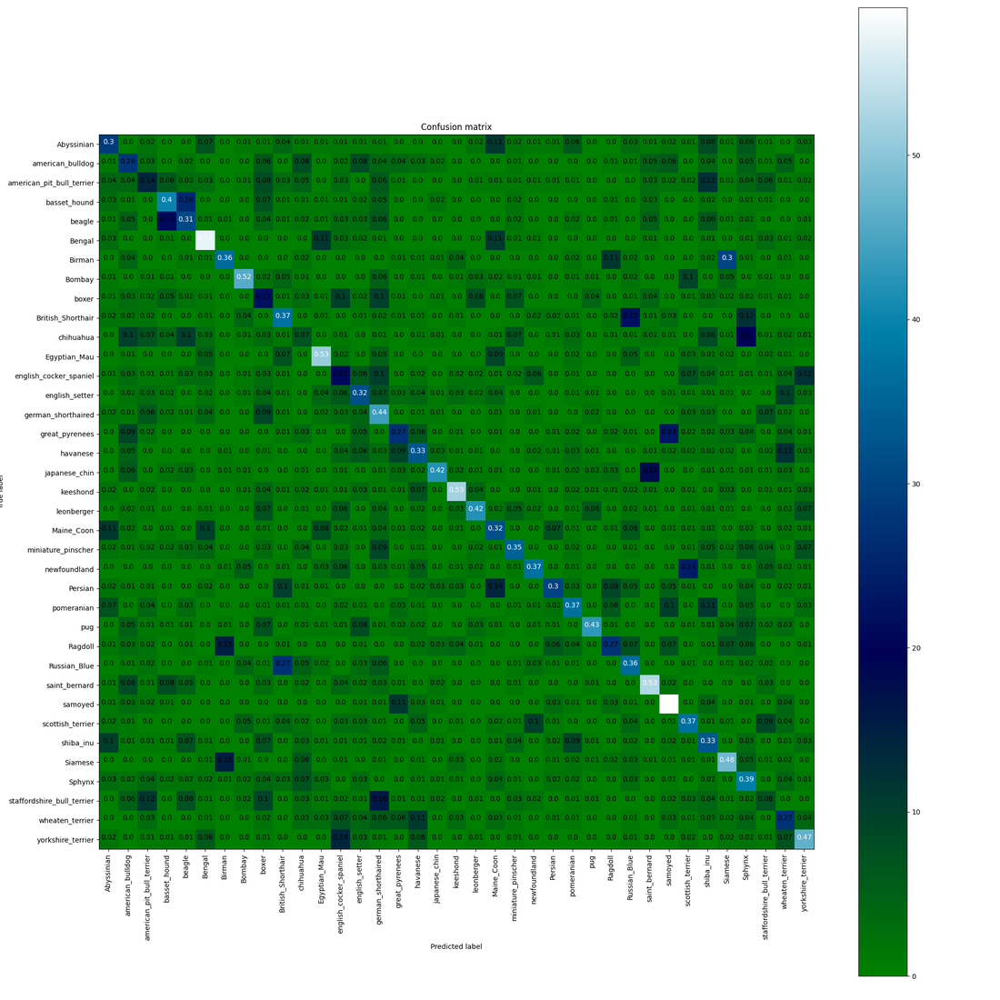
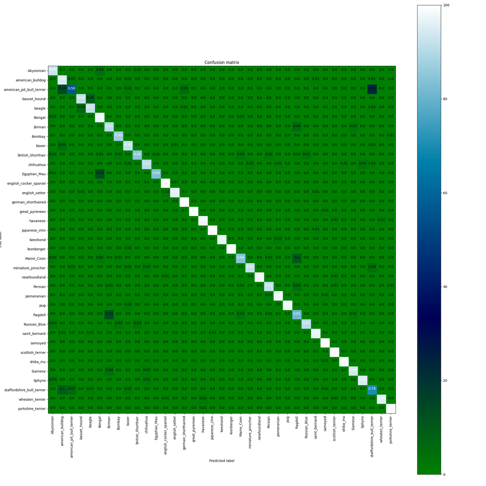
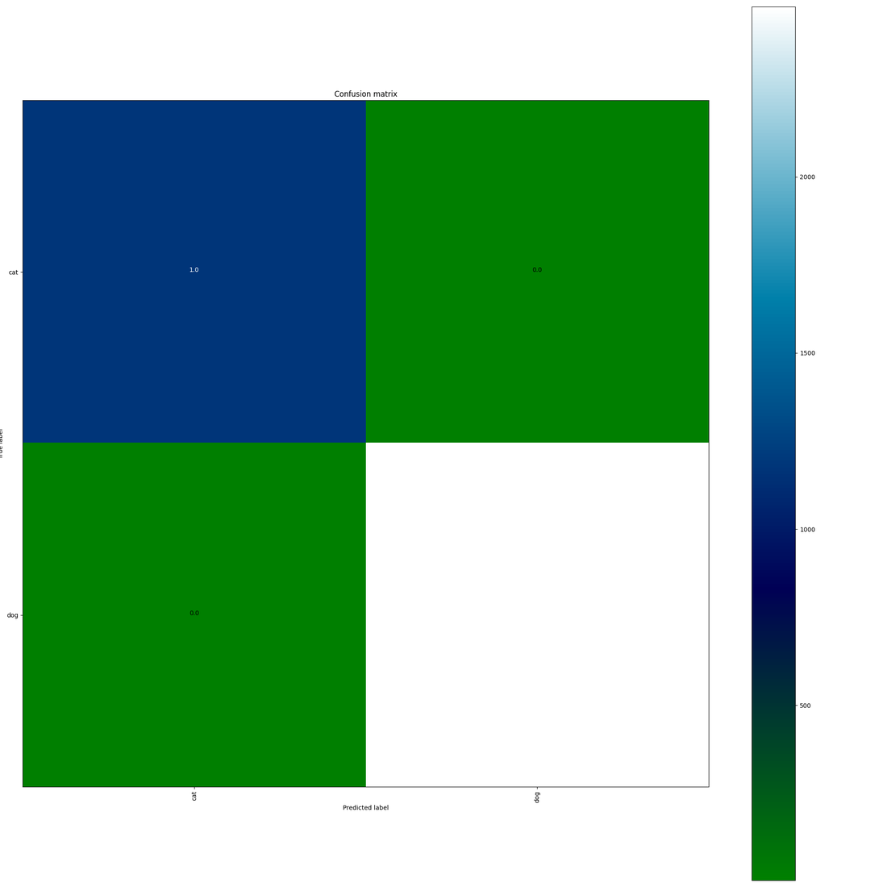

<h1 align="center">ResNet-50 in PyTorch</h1>

<p align="center">
  ResNet-50 for pet breed classification on the Oxford-IIIT Pet dataset: a from-scratch implementation and an ImageNet-pretrained transfer-learning variant.
</p>

<p align="center">
  
  
  
</p>

---

## Table of Contents

- [Overview](#overview)
- [Features](#features)
- [Project Structure](#project-structure)
- [Model Architecture](#model-architecture)
- [Dataset](#dataset)
- [Getting Started](#getting-started)
- [Usage](#usage)
- [Transfer Learning](#transfer-learning)
- [Training Configuration](#training-configuration)
- [Results](#results)
  - [How to reproduce](#how-to-reproduce)
- [Project Status](#project-status)
- [License](#license)
- [References](#references)

## Overview
[](https://gitdiagram.com/bzaat/pytorch-resnet50v1-implementation?utm_source=readme&utm_medium=picture)

This project implements the ResNet-50 architecture from scratch in PyTorch and trains it on the [Oxford-IIIT Pet Dataset](https://www.robots.ox.ac.uk/~vgg/data/pets/) (37 cat and dog breeds). It is a learning-oriented codebase focused on three things: understanding CNN architectures, building a clean data pipeline, and setting up a reproducible training workflow.

Two models are included so they can be compared on the same data: a ResNet-50 trained from scratch (`oxiii_pet.model`), and a `torchvision` ResNet-50 pretrained on ImageNet and fine-tuned on the pet dataset (`oxiii_pet.transfer_learning`).

| Model (37 breeds, official test split) | Best test accuracy (epoch) | Final epoch |
|----------------------------------------|:------------------:|:-----------:|
| ResNet-50 from scratch, 50 epochs | 36.09% (48) | 35.92% |
| Pretrained ResNet-50, fine-tuned, 10 epochs | **93.35%** (9) | **93.35%** |

Numbers from the logged re-run of 2026-11-13 (seed 42, RTX 3050 Laptop GPU); see [`results/summary.md`](results/summary.md) and [How to reproduce](#how-to-reproduce).

## Features

- **ResNet-50 from scratch:** bottleneck residual blocks, projection shortcuts, and a configurable classification head, with no dependency on `torchvision.models` (`oxiii_pet/model/models.py`).
- **Transfer learning:** an ImageNet-pretrained `torchvision` ResNet-50 (V1 or V2 weights) with a new classification head; only the head and `layer4` are trained, and the rest of the backbone stays frozen.
- **Custom `Dataset`:** reads the official annotation files, builds image paths, converts labels to zero-based indices, and loads images as RGB with Pillow.
- **Train / evaluation splits:** `trainval.txt` for training and `test.txt` for evaluation.
- **Two task modes:** 37-breed classification (default) or binary cat-vs-dog classification, selected with `--num_class`.
- **Training script with CLI:** configurable epochs, batch size, data directory and log directory.
- **Experiment tracking:** every run gets its own folder (`runs/<date>_<experiment>/`) with a `train.log`, a `metrics.csv` (one row per epoch), a `config.json` (all arguments, seed, library versions, GPU and git commit), a `summary.json`, and TensorBoard logs (train/test loss and accuracy, learning rate, per-epoch confusion matrix). tqdm shows loss, accuracy and learning rate live.
- **Reproducibility:** seeds for Python, NumPy, PyTorch and the DataLoader (`--seed`, default 42), recorded in `config.json`.
- **Checkpointing and resume:** the latest and the best checkpoints are saved automatically for both models; the from-scratch run can be resumed from either.
- **Inference script:** classify one image or a whole folder with the same preprocessing as evaluation, printing the top-3 breeds.
- **CPU and GPU support:** training and evaluation run on CUDA when available and fall back to the CPU otherwise.
- **Installable package managed with [uv](https://docs.astral.sh/uv/):** `uv sync` installs the locked dependencies and the project in editable mode, so `oxiii_pet` is importable from anywhere.

## Project Structure

```text
.
├── LICENSE
├── pyproject.toml
├── uv.lock
├── results/                              # summary.md, curves (PNG) and per-run logs/metrics
└── src/
    └── oxiii_pet/
        ├── dataset/
        │   ├── dataset_oxiiit_pet.py     # OxfordData: custom Dataset
        │   └── dataloader_oxiii_pet.py   # DataLoader smoke test
        ├── model/                        # ResNet-50 from scratch
        │   ├── models.py                 # Bottleneck block and Resnet50
        │   ├── train.py                  # Training and evaluation entry point
        │   └── test.py                   # Inference on an image or a folder
        ├── transfer_learning/            # Pretrained ResNet-50 fine-tuning
        │   ├── transfer_learning.py      # MyModel: pretrained backbone + new head
        │   ├── train.py                  # Fine-tuning and evaluation entry point
        │   └── test.py                   # Inference on an image or a folder
        └── utils/
            ├── run_utils.py              # Seeding, run folder, logging, metrics.csv, train/eval loop
            ├── inference.py              # Shared preprocessing and checkpoint loading for test.py
            ├── plot_metrics.py           # Loss/accuracy curves from metrics.csv
            └── export_tb_images.py       # Export a TensorBoard image (confusion matrix) to PNG
```

## Model Architecture

The network follows the standard ResNet-50 layout: a convolutional stem, four stages of bottleneck blocks (3-4-6-3), and a global-pooling classification head. Shapes below assume a 224 × 224 input.

| Stage | Block (1×1 → 3×3 → 1×1) | Repeats | Output channels | Output size |
|-------|-------------------------|:-------:|:---------------:|:-----------:|
| `stem` | 7×7 conv (stride 2) + 3×3 max-pool (stride 2) | 1 | 64 | 56 × 56 |
| `conv2_x` | 64 → 64 → 256 | 3 | 256 | 56 × 56 |
| `conv3_x` | 128 → 128 → 512 | 4 | 512 | 28 × 28 |
| `conv4_x` | 256 → 256 → 1024 | 6 | 1024 | 14 × 14 |
| `conv5_x` | 512 → 512 → 2048 | 3 | 2048 | 7 × 7 |
| `fc` | AdaptiveAvgPool → Flatten → Dropout(0.5) → Linear | 1 | 37 | – |

Each bottleneck block uses a residual (identity) connection. A 1×1 projection shortcut is applied whenever the spatial size or channel count changes. Downsampling is done by the stride of the 3×3 convolution.

## Dataset

The project uses the [Oxford-IIIT Pet Dataset](https://www.robots.ox.ac.uk/~vgg/data/pets/): roughly 7,400 images of 37 cat and dog breeds.

Each line of an annotation file has the format:

```text
<image_name> <class_id> <species> <breed_id>
```

Expected directory structure (the dataset root defaults to `data/`):

```text
data/
├── annotations/
│   ├── trainval.txt
│   └── test.txt
└── images/
    ├── Abyssinian_1.jpg
    ├── Abyssinian_2.jpg
    └── ...
```

### Data pipeline

The `OxfordData` class (`src/oxiii_pet/dataset/dataset_oxiiit_pet.py`) inherits from `torch.utils.data.Dataset`:

1. **Load annotations:** reads `trainval.txt` when `train=True`, or `test.txt` when `train=False`.
2. **Select the label column:** keeps the image name plus one label column, chosen by `num_class`: the breed class ID for 37 classes, or the species (cat/dog) for 2 classes. Any other value is rejected.
3. **Build paths:** joins `root/images/<image_name>.jpg`.
4. **Map labels:** converts 1-based class IDs to 0-based indices (`label - 1`).
5. **Load images:** opens each image with Pillow and converts it to RGB.
6. **Transform:** applies the optional `transform`.
7. **Return samples:** each item is an `(image, label)` pair.

## Getting Started

### Prerequisites

- [uv](https://docs.astral.sh/uv/getting-started/installation/) (it can also download a suitable Python for you)
- Python 3.10 or newer
- (Optional) An NVIDIA GPU with CUDA for faster training

### Installation

```bash
# 1. Install uv (once)
curl -LsSf https://astral.sh/uv/install.sh | sh     # Windows (PowerShell): powershell -c "irm https://astral.sh/uv/install.ps1 | iex"

# 2. Clone the repository
git clone https://github.com/bzaat/pytorch-resnet50v1-implementation.git
cd pytorch-resnet50v1-implementation

# 3. Create .venv and install the locked dependencies and the project (editable)
uv sync
```

`uv sync` reads `pyproject.toml` and `uv.lock`, creates a `.venv` in the project folder and installs everything into it. There is no need to activate the environment: prefix commands with `uv run` (as in the examples below), or activate `.venv` yourself if you prefer.

> **GPU users:** the default PyPI build of PyTorch on Linux includes CUDA support. For a CPU-only build or a specific CUDA version, follow uv's [PyTorch guide](https://docs.astral.sh/uv/guides/integration/pytorch/).

Verify the installation:

```bash
uv run python -c "import torch; print(torch.__version__, torch.cuda.is_available())"
```

### Download the dataset

```bash
mkdir -p data && cd data

curl -O https://www.robots.ox.ac.uk/~vgg/data/pets/data/images.tar.gz
curl -O https://www.robots.ox.ac.uk/~vgg/data/pets/data/annotations.tar.gz

tar -xzf images.tar.gz
tar -xzf annotations.tar.gz
cd ..
```

By default the code looks for the dataset in `data/`. To use another location, set the `DATA_DIR` environment variable or pass `--dir` to the training script:

```bash
export DATA_DIR=/path/to/oxford-iiit-pet     # Windows (PowerShell): $env:DATA_DIR = "C:\path\to\oxford-iiit-pet"
```

## Usage

### 1. Check the data pipeline

Run the DataLoader smoke test to confirm the dataset is found and batches have the expected shape:

```bash
uv run python src/oxiii_pet/dataset/dataloader_oxiii_pet.py
```

Or use the dataset directly in Python. The first argument of `OxfordData` is the number of classes: `37` for breeds or `2` for cat vs dog:

```python
import torch
from torch.utils.data import DataLoader
from torchvision.transforms.v2 import Compose, Resize, ToDtype, ToImage

from oxiii_pet.dataset.dataset_oxiiit_pet import OxfordData

transform = Compose([Resize((224, 224)), ToImage(), ToDtype(torch.float32, scale=True)])

train_set = OxfordData(37, "data", train=True, transform=transform)
loader = DataLoader(train_set, batch_size=16, shuffle=True, num_workers=4, drop_last=True)

images, labels = next(iter(loader))
print(images.shape)   # torch.Size([16, 3, 224, 224])
print(labels.shape)   # torch.Size([16])
```

### 2. Train the model

```bash
uv run python -m oxiii_pet.model.train --epochs 50 --batch_size 32 --dir data
```

| Argument | Short | Default | Description |
|----------|:-----:|---------|-------------|
| `--epochs` | `-e` | `10` | Number of training epochs |
| `--batch_size` | `-b` | `8` | Batch size for both splits |
| `--images_size` | `-i` | `224` | Input image size |
| `--dir` | `-d` | `$DATA_DIR` or `data` | Dataset root directory |
| `--run_dir` | `-r` | `runs/<date>_scratch_<n>cls` | Run folder for `train.log`, `metrics.csv`, `config.json`, `summary.json` |
| `--logging` | `-l` | `<run_dir>/tensorboard` | Directory for TensorBoard logs |
| `--trained_model` | `-t` | `<run_dir>/checkpoints` | Directory where checkpoints are saved |
| `--checkpoint` | `-c` | none | Checkpoint to resume training from |
| `--num_class` | `-n` | `37` | Number of classes: `37` for breeds, `2` for cat vs dog |
| `--clip` | `-cl` | `0` | Gradient-norm clipping threshold; `0` disables clipping |
| `--seed` | `-s` | `42` | Random seed |
| `--num_workers` | `-w` | `4` | DataLoader worker processes |

After every epoch the model is evaluated on the test split. Two checkpoints are written: `last_model.pth` after every epoch, and `best_model.pth` whenever test accuracy improves. Each checkpoint stores the epoch, model, optimizer and scheduler state, the best accuracy and epoch, and the class names.

To resume an interrupted run, pass the checkpoint and the same `--run_dir` and `--epochs` so the learning-rate schedule stays consistent and `metrics.csv` keeps growing:

```bash
uv run python -m oxiii_pet.model.train --epochs 50 --batch_size 32 \
    --run_dir runs/<run> --checkpoint runs/<run>/checkpoints/last_model.pth
```

To train the binary cat-vs-dog task instead of the 37 breeds, pass `--num_class 2`:

```bash
uv run python -m oxiii_pet.model.train --epochs 50 --batch_size 32 --num_class 2
```

### 3. Monitor training

```bash
uv run tensorboard --logdir runs/
```

Logged scalars: `Train/Loss` (per iteration), `Train/EpochLoss`, `Train/Accuracy`, `Validation/Loss`, `Validation/Accuracy`, `LR`. ("Validation" is the official test split.)

Logged images: `confusion_matrix`, the confusion matrix of the test split with breed names on the axes, written once per epoch by `plot_confusion_matrix` in `utils/run_utils.py` (scikit-learn computes the matrix and matplotlib draws it). Open the **Images** tab and drag the slider to see how the errors change during training. Rows are the true classes and columns are the predicted classes; each cell shows the fraction of that true class predicted as the column class, so the diagonal is the per-class recall.

### 4. Classify images

Both `test.py` scripts apply the evaluation preprocessing (resize to 224 × 224, ImageNet mean/std normalization) and print the top-3 classes for one image or every image in a folder. Class names are read from the checkpoint (or from the dataset annotations for older checkpoints), in the dataset's label order.

```bash
# From-scratch model; -c takes a .pth file or a run folder (default: newest runs/*scratch*/checkpoints/best_model.pth)
uv run python -m oxiii_pet.model.test -c runs/<run> -t test_images

# Transfer-learning model (default: newest runs/*transfer*/checkpoints/best_model.pth); add -n 2 for cat vs dog
uv run python -m oxiii_pet.transfer_learning.test -c runs/<run> -t test_images/1.jpg
```

| Argument | Short | Default | Description |
|----------|:-----:|---------|-------------|
| `--checkpoint` | `-c` | newest best checkpoint under `runs/` | `.pth` file or run folder |
| `--test_path` | `-t` | `test_images` | Image file or folder |
| `--num_class` | `-n` | `37` | Must match the checkpoint |
| `--images_size` | `-i` | `224` | Input image size |
| `--data_dir` | `-d` | `$DATA_DIR` or `data` | Only used for class names if the checkpoint has none |
| `--version` | `-v` | `2` | Transfer-learning test only: ImageNet weights version of the backbone |

### 5. Load a trained checkpoint in Python

```python
import torch
from oxiii_pet.model.models import Resnet50

model = Resnet50(num_classes=37)  # use 2 if you trained with --num_class 2
checkpoint = torch.load("runs/<run>/checkpoints/best_model.pth", map_location="cpu")
model.load_state_dict(checkpoint["model"])
model.eval()

print(f"Loaded checkpoint from epoch {checkpoint['epoch']}")
```

## Transfer Learning

`oxiii_pet.transfer_learning` fine-tunes a `torchvision` ResNet-50 that was pretrained on ImageNet-1K, using the same data pipeline, transforms and optimizer settings as the from-scratch model.

**Design** (`transfer_learning/transfer_learning.py`)

| Part | Setting |
|------|---------|
| Backbone | `torchvision.models.resnet50` with `IMAGENET1K_V2` weights (default) or `IMAGENET1K_V1` (`--version 1`) |
| Head | the original `fc` is removed and replaced by `Dropout(0.5)` → `Linear(2048, 1024)` → `ReLU` → `Linear(1024, num_classes)` |
| Trainable | the new head and `layer4`; the stem and `layer1`–`layer3` are frozen (`requires_grad=False`) |
| BatchNorm | `MyModel.train()` keeps the whole pretrained backbone, including `layer4`, in eval mode, so its BatchNorm layers keep using the ImageNet running statistics instead of re-estimating them from batches of the pet data; only their scale and shift are trained in `layer4` |

Freezing parameters with `requires_grad=False` does not stop BatchNorm from updating its running mean and variance, because those are buffers updated in the forward pass whenever the layer is in train mode. This is why `train()` is overridden.

**Train**

```bash
uv run python -m oxiii_pet.transfer_learning.train -n 37 --epoch 10 --batch_size 32
```

| Argument | Short | Default | Description |
|----------|:-----:|---------|-------------|
| `--data_path` | `-d` | `$DATA_DIR` or `data` | Dataset root directory |
| `--epoch` | `-e` | `10` | Number of training epochs |
| `--image_size` | `-s` | `224` | Input image size |
| `--num_classes` | `-n` | `37` | Number of classes: `37` for breeds, `2` for cat vs dog |
| `--batch_size` | `-b` | `32` | Batch size for both splits |
| `--version` | `-v` | `2` | ImageNet-1K weights: `1` = V1, `2` = V2 |
| `--run_dir` | `-r` | `runs/<date>_transfer_<n>cls` | Run folder for logs, metrics, config and TensorBoard |
| `--trained_model` | `-t` | `<run_dir>/checkpoints` | Directory for the saved weights (created automatically) |
| `--seed` | | `42` | Random seed |
| `--num_workers` | `-w` | `4` | DataLoader worker processes |

After every epoch the model is evaluated on the test split. `last_model.pth` is written every epoch and `best_model.pth` whenever test accuracy improves; both store the model weights, epoch, accuracy, class names and weights version. The run folder gets the same `train.log`, `metrics.csv`, `config.json`, `summary.json` and TensorBoard logs as the from-scratch script. Resuming is not supported.

## Training Configuration

| Component | Setting |
|-----------|---------|
| Loss | `CrossEntropyLoss` |
| Optimizer | SGD, learning rate `1e-2`, momentum `0.9`, weight decay `1e-4` |
| LR schedule | `CosineAnnealingLR` over all epochs (`T_max` = number of epochs), stepped once per epoch |
| Weight init | Kaiming normal (convolutions), BatchNorm weight 1 / bias 0, Linear `N(0, 0.01)` |
| Train transforms | `RandomResizedCrop(224, scale=(0.6, 1.0))`, `RandomHorizontalFlip`, ImageNet mean/std normalization |
| Test transforms | `Resize((224, 224))`, ImageNet mean/std normalization |
| DataLoader | 4 workers, `drop_last=True` for training |
| Evaluation | Test split, once per epoch |
| Output classes | 37 breeds by default, or 2 (cat vs dog) with `--num_class 2` |

The transfer-learning script uses the same optimizer, schedule, transforms and DataLoader settings (see [Transfer Learning](#transfer-learning)).

## Results

All results come from the logged re-run of 2026-11-13: seed 42, one NVIDIA RTX 3050 6GB Laptop GPU, PyTorch 2.14.1+cu130, commit `0cfedcf`. Each run's `config.json`, `metrics.csv`, `summary.json` and `train.log` are in [`results/`](results/), together with loss/accuracy curves; [`results/summary.md`](results/summary.md) has the combined table.

The repo has no separate validation split: the official `test.txt` split is used both to pick `best_model.pth` and to report accuracy. The **best** epoch is therefore slightly optimistic; the **final** epoch (`last_model.pth`) is the unbiased number. All runs use a single seed, and from-scratch accuracy moves 1–2 points between consecutive epochs, so treat differences of that size as noise.

### From scratch (37 breeds)

ResNet-50 trained from scratch (no pretrained weights) for 50 epochs with batch size 32, using the configuration above.

| Metric | Value |
|--------|-------|
| Best test accuracy (`best_model.pth`) | **36.09%** (epoch 48) |
| Final test accuracy (`last_model.pth`, epoch 50) | 35.92% |
| Lowest test loss | 2.679 (epoch 26) |
| Final test loss | 3.711 |
| Final training accuracy (augmented images) | 77.96% |
| Random-guess reference | 2.7% accuracy, loss ≈ 3.61 |
| Training time | ≈ 53 s/epoch (median); ≈ 45 min in total |


<details>
<summary>Confusion matrix on the test split, final epoch (from TensorBoard)</summary>



</details>

**Notes**

- The model overfits: training accuracy reaches 78% while test accuracy levels off around 35–36%, and the test loss is lowest at epoch 26 and drifts upward afterwards.
- While the learning rate is high, the test loss has isolated spikes (epochs 3, 14 and 22, up to 16.2) that recover in the next epoch; they fade as the cosine schedule lowers the learning rate.
- Training a 25M-parameter network from scratch on about 3.7k images is data-limited; starting from pretrained weights removes most of that limit (see the transfer-learning results below).

### Transfer learning (37 breeds)

Fine-tuning the pretrained ResNet-50 (`IMAGENET1K_V2`, trainable head + `layer4`) for 10 epochs with batch size 32 and the default settings of the transfer-learning script, on the same official `test.txt` split.

| Metric | Value |
|--------|-------|
| Best test accuracy (`best_model.pth`) | **93.35%** (epoch 9) |
| Final test accuracy (`last_model.pth`, epoch 10) | 93.35% |
| Lowest test loss | 0.280 (epoch 9) |
| Final test loss | 0.288 |
| Final training accuracy (augmented images) | 99.43% |
| From-scratch reference | 36.09% best, 2.679 lowest test loss |
| Training time | 5.2 min (≈ 30 s/epoch) |

| Epoch | 1 | 2 | 3 | 4 | 5 | 6 | 7 | 8 | 9 | 10 |
|-------|:-:|:-:|:-:|:-:|:-:|:-:|:-:|:-:|:-:|:--:|
| Test accuracy (%) | 75.01 | 84.71 | 83.40 | 89.70 | 89.53 | 90.35 | 92.89 | 92.48 | 93.35 | 93.35 |
| Test loss | 0.874 | 0.484 | 0.541 | 0.349 | 0.390 | 0.364 | 0.310 | 0.323 | 0.280 | 0.288 |


<details>
<summary>Confusion matrix on the test split, final epoch (from TensorBoard)</summary>



</details>

The remaining errors are mostly between similar-looking breeds: in the final-epoch confusion matrix, `american_pit_bull_terrier` has the lowest recall (0.56) and is mostly predicted as `staffordshire_bull_terrier` (0.23) or `american_bulldog` (0.14), and `Egyptian_Mau` → `Bengal` and `Ragdoll` → `Birman` each account for 0.13 of those classes.

**Notes**

- Pretraining on ImageNet raises 37-breed test accuracy from about 36% to about 93%, and one epoch already beats the 50-epoch from-scratch run (75.0% vs 36.1%).
- Best and final epoch reach the same accuracy here (93.35%), so the test-split selection bias does not change the headline number for this run.
- Training accuracy reaches 99.4% while test loss stays near 0.28–0.29 in the last epochs, so some overfitting remains.

### Transfer learning (cat vs dog)

The same setup with `-n 2` (10 epochs, batch size 32, seed 42).

| Metric | Value |
|--------|-------|
| Best test accuracy (`best_model.pth`) | **99.84%** (epoch 4) |
| Final test accuracy (`last_model.pth`, epoch 10) | 99.78% |
| Lowest test loss | 0.006 (epoch 4) |
| Final test loss | 0.008 |
| Training time | 4.9 min (≈ 30 s/epoch) |

Test accuracy is already 99.37% after the first epoch and stays between 99.40% and 99.84% afterwards. The task is easy for ImageNet features, so it mostly serves as a sanity check.


<details>
<summary>Confusion matrix on the test split, final epoch (from TensorBoard)</summary>



</details>

### How to reproduce

```bash
uv sync
uv run python -c "import torch; print(torch.__version__, torch.cuda.is_available())"

# A. From scratch, 37 breeds (≈ 45 min on an RTX 3050 Laptop GPU)
uv run python -m oxiii_pet.model.train -e 50 -b 32 -n 37 -d data --seed 42 --run_dir runs/2026-11-13_A_scratch_37cls

# B. Transfer learning, 37 breeds (≈ 5 min)
uv run python -m oxiii_pet.transfer_learning.train -e 10 -n 37 -b 32 -v 2 -d data --seed 42 --run_dir runs/2026-11-13_B_transfer_37cls

# C. Transfer learning, cat vs dog (≈ 5 min)
uv run python -m oxiii_pet.transfer_learning.train -e 10 -n 2 -b 32 -v 2 -d data --seed 42 --run_dir runs/2026-11-13_C_transfer_2cls

# Sanity check on the bundled images
uv run python -m oxiii_pet.model.test -c runs/2026-11-13_A_scratch_37cls -t test_images
uv run python -m oxiii_pet.transfer_learning.test -c runs/2026-11-13_B_transfer_37cls -t test_images
uv run python -m oxiii_pet.transfer_learning.test -n 2 -c runs/2026-11-13_C_transfer_2cls -t test_images

# Curves, confusion-matrix export and TensorBoard
uv run python -m oxiii_pet.utils.plot_metrics runs/2026-11-13_A_scratch_37cls -o results/A_scratch_37cls_curves.png
uv run python -m oxiii_pet.utils.export_tb_images runs/2026-11-13_A_scratch_37cls -o results/A_scratch_37cls_confusion_matrix.png
uv run tensorboard --logdir runs/
```

cuDNN is not forced into deterministic mode, so a re-run on a GPU will not reproduce these numbers bit-for-bit.

## Project Status

The project is complete: data pipeline, ResNet-50 from scratch, training with TensorBoard logging and checkpointing, and a transfer-learning variant. On the 37-breed task the from-scratch model reaches about 36% test accuracy and the fine-tuned pretrained model about 93% (re-run of 2026-11-13, see [Results](#results)).

**Done**

- [x] Custom `Dataset` and `DataLoader` for Oxford-IIIT Pet (37 classes)
- [x] ResNet-50 implemented from scratch
- [x] Training loop with TensorBoard logging and best-model checkpointing
- [x] Installable package with dependencies declared in `pyproject.toml` and locked with uv (`uv.lock`)
- [x] Input normalization and data augmentation (ImageNet mean/std, random resized crop, horizontal flip)
- [x] Cosine learning-rate schedule and weight decay
- [x] Full 50-epoch training run with normalization and augmentation (36.09% best / 35.92% final test accuracy)
- [x] Per-run logging: `train.log`, `metrics.csv`, `config.json` (seed, versions, git commit), TensorBoard, tqdm
- [x] Device-agnostic training and evaluation (CPU fallback)
- [x] Resumable training (latest and best checkpoints with optimizer and scheduler state)
- [x] Per-epoch confusion matrix logged to TensorBoard
- [x] Binary (cat vs dog) and 37-breed modes selectable with `--num_class`
- [x] Transfer learning from ImageNet-pretrained ResNet-50 (frozen backbone except `layer4`, BatchNorm kept in eval mode): 93.35% test accuracy on 37 breeds versus 36.09% from scratch

## License

Distributed under the MIT License. See [`LICENSE`](LICENSE) for details.

## References

- [Deep Residual Learning for Image Recognition](https://arxiv.org/abs/1512.03385) — He et al., 2015
- [Oxford-IIIT Pet Dataset](https://www.robots.ox.ac.uk/~vgg/data/pets/) — Parkhi et al., 2012
- [PyTorch Documentation](https://pytorch.org/docs/stable/index.html)
- [Torchvision Documentation](https://pytorch.org/vision/stable/index.html)
- [Torchvision ResNet-50 weights](https://pytorch.org/vision/stable/models/generated/torchvision.models.resnet50.html)
