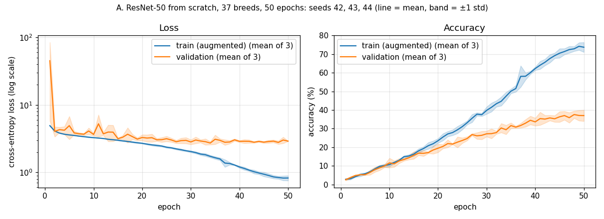
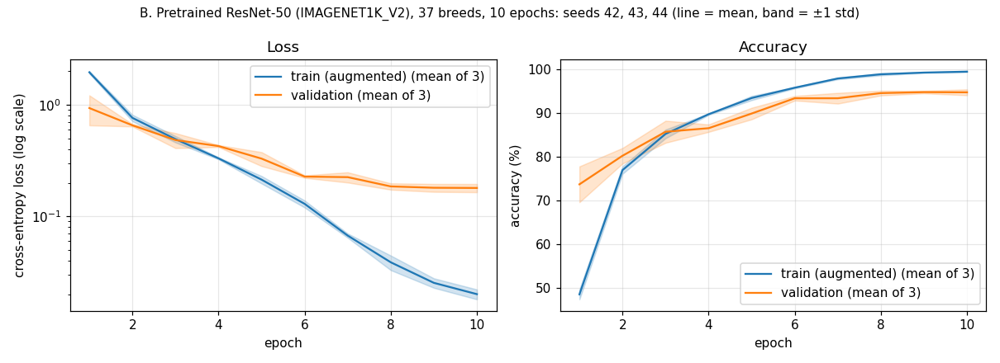
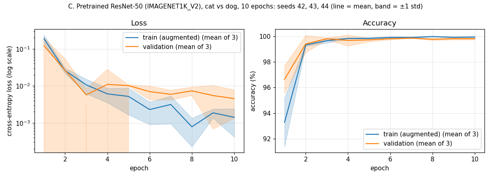
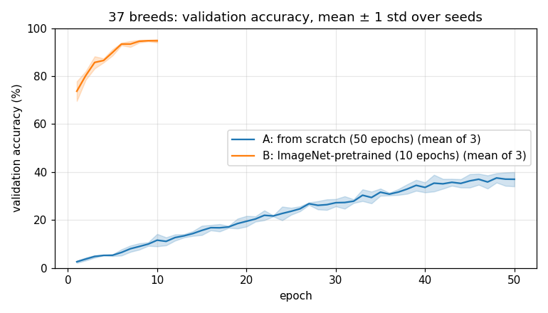

# Results summary (3 seeds, checkpoint selected on validation)

Runs of 2026-11-13, training seeds 42, 43 and 44, commit `8ba4cee` (clean working tree), one NVIDIA RTX 3050 6GB Laptop GPU, PyTorch 2.14.1+cu130. The hyperparameters are the ones the repo used before this change (no tuning).

**Protocol in short.** Train on 80% of `trainval.txt` (2944 images). Validate every epoch on the other 20% (736 images; stratified by breed, split seed 0, [`../splits/trainval_80_20_seed0.json`](../splits/trainval_80_20_seed0.json)). `best_model.pth` = highest validation accuracy (ties: earlier epoch); `last_model.pth` = final epoch. After training, each of the two checkpoints is evaluated **once** on the official `test.txt` split (3669 images). The test split plays no part in any choice. Full protocol: [README, Experimental Protocol](../README.md#experimental-protocol).

Mean ± sample standard deviation (n − 1) over the 3 seeds. Accuracies in %, rounded to two decimals.

## Aggregate

| Experiment | n | Test acc, best-val checkpoint (%) | Test acc, last epoch (%) | Val acc at best (%) | Train acc at last (augmented, %) | Train time (min) |
|---|:-:|:-:|:-:|:-:|:-:|:-:|
| A. ResNet-50 from scratch, 37 breeds, 50 epochs | 3 | **30.80 ± 1.45** | 31.28 ± 1.35 | 37.59 ± 1.96 | 73.68 ± 2.62 | 30.06 ± 1.23 |
| B. Pretrained ResNet-50 (IMAGENET1K_V2), 37 breeds, 10 epochs | 3 | **92.39 ± 0.27** | 92.45 ± 0.22 | 94.93 ± 0.51 | 99.47 ± 0.12 | 3.12 ± 0.06 |
| C. Pretrained ResNet-50 (IMAGENET1K_V2), cat vs dog, 10 epochs | 3 | **99.65 ± 0.07** | 99.61 ± 0.04 | 99.91 ± 0.08 | 99.95 ± 0.04 | 2.89 ± 0.01 |

Train time is the sum of the per-epoch times (training + validation), without the final test evaluation and without time lost to the crash of A seed 43 (see below).

## Per seed

| Experiment | Seed | Val best epoch / last | Val acc at best (%) | Test acc at best-val (%) | Test loss at best-val | Test acc at last epoch (%) | Test loss at last | Train acc at last (augmented, %) | Train time (min) |
|---|:-:|:-:|:-:|:-:|:-:|:-:|:-:|:-:|:-:|
| A | 42 | 41 / 50 | 38.72 | 30.74 | 3.1512 | 31.40 | 3.5155 | 72.25 | 28.67 |
| A | 43 † | 48 / 50 | 35.33 | 29.38 | 3.7715 | 29.87 | 3.6746 | 76.70 | 30.50 |
| A | 44 | 48 / 50 | 38.72 | 32.27 | 3.5487 | 32.57 | 3.7862 | 72.08 | 31.02 |
| B | 42 | 10 / 10 | 95.52 | 92.70 | 0.2906 | 92.70 | 0.2906 | 99.35 | 3.09 |
| B | 43 | 9 / 10 | 94.70 | 92.23 | 0.3342 | 92.26 | 0.3305 | 99.46 | 3.09 |
| B | 44 | 9 / 10 | 94.57 | 92.23 | 0.3002 | 92.40 | 0.3012 | 99.59 | 3.19 |
| C | 42 | 4 / 10 | 100.00 | 99.62 | 0.0116 | 99.56 | 0.0152 | 99.93 | 2.91 |
| C | 43 | 7 / 10 | 99.86 | 99.73 | 0.0116 | 99.62 | 0.0132 | 99.93 | 2.88 |
| C | 44 | 3 / 10 | 99.86 | 99.59 | 0.0208 | 99.65 | 0.0127 | 100.00 | 2.89 |

The artifacts of every run (`config.json`, `metrics.csv`, `summary.json`, `train.log`, test confusion matrix of the best-val checkpoint) are in `results/<experiment>/seed<k>/`. Checkpoints and TensorBoard files stay local in `runs/` (gitignored). The tables above are generated by `uv run python -m oxiii_pet.utils.aggregate_results --date 2026-11-13` (also written to [`tables.md`](tables.md) and [`aggregate.json`](aggregate.json)).

### † A seed 43 was interrupted and resumed

- The first attempt crashed during epoch 37, with exit code 1. Epoch 36 finished at 20:05:41 and the exit was logged at 20:09:52, while an epoch normally takes about 40 s. Epochs 1–36 and their checkpoints were complete. No traceback was kept, because the run script sent stdout/stderr to `/dev/null` at the time (fixed: it now writes `stdout_stderr.txt` per run). The kernel log shows GPU-passthrough (`dxg`) ioctl errors around that time, so a GPU/driver problem is likely, but the cause is not confirmed. A second resume attempt was stopped by the host for low memory before epoch 37 finished and changed nothing.
- The run was resumed from the epoch-36 `last_model.pth` (model, optimizer and LR scheduler state) with the same seed, split and settings, and finished epochs 37–50. The test split had not been used before the resume.
- **Deviation:** the resume code at that commit called `set_seed(43)` again and did not restore the random-number state, so epoch 37 replayed the shuffle order and augmentations of epoch 1. Train accuracy jumps from 49.56% (epoch 36) to 64.64% (epoch 37), while the other two seeds gain about 2 points at that epoch, and the A curve shows a bump at epoch 37. Validation accuracy shows no jump (30.71% → 30.30%). Seed 43's training after epoch 36 therefore differs from an uninterrupted run, and its final train accuracy (76.70%) is inflated relative to the other seeds. Its validation and test numbers are reported unchanged. The resume code is now fixed: checkpoints store the RNG state and a resume restores it.
- Evidence: `A_scratch_37cls/seed43/config_initial.json` (original run), `config.json` (resume), `train_until_crash.log`, `resume_stdout_stderr.txt`.

## Plots

Train vs validation, mean over the 3 seeds with a ±1 std band:

Validation accuracy, A vs B:

Test confusion matrices (best-val checkpoint, one per seed): `A_scratch_37cls/seed42/test_confusion_matrix_best_val.png` and the same file for every experiment and seed.

## Difference from the previous (superseded) numbers

The previous README reported single-seed runs (seed 42) whose `best_model.pth` was chosen on the test split ([`legacy_test_selected/`](legacy_test_selected/)).

| Experiment | Old: best test acc (test-selected) | Old: final epoch | New: test acc at best-val (mean of 3) | New: test acc at last epoch (mean of 3) | Change, best | Change, last |
|---|:-:|:-:|:-:|:-:|:-:|:-:|
| A | 36.09% | 35.92% | 30.80% | 31.28% | −5.29 pp | −4.64 pp |
| B | 93.35% | 93.35% | 92.39% | 92.45% | −0.96 pp | −0.90 pp |
| C | 99.84% | 99.78% | 99.65% | 99.61% | −0.19 pp | −0.17 pp |

All three are lower. Two changes act together and cannot be separated with these runs:

1. Models are now trained on 2944 instead of 3680 images, since 20% of `trainval.txt` is held out for validation.
2. The checkpoint is no longer picked on the test split.

The second can only explain part of the gap: the old final-epoch numbers involved no selection, and they are also higher (A: 35.92% vs 31.28% now). The larger drop for A is consistent with a from-scratch model being the most data-limited. The new runs also differ by seed: the old values were seed 42 only.

## Notes

- **A overfits.** Augmented train accuracy reaches about 72–77%, while validation accuracy ends at 33.56–38.72% and test accuracy at 29.38–32.57%. Validation loss on the first epoch is very large for two seeds (85.1 and 43.3; 6.7 for the third) and drops to about 4 by epoch 2. The loss plot uses a log scale for that reason.
- **A's validation accuracy is higher than its test accuracy** (37.59% vs 30.80%). Part of this comes from choosing the best of 50 noisy epochs on only 736 images (about 20 per breed), which is exactly the bias the test split is kept free of. The validation and test images may also simply differ.
- **B and C barely depend on the checkpoint choice.** Best-val and last-epoch test accuracy differ by at most 0.17 points per seed.
- **C saturates.** One seed reaches 100.00% validation accuracy at epoch 4, and test accuracy stays between 99.56% and 99.73% for every seed and checkpoint.
- **Not bit-exact.** cuDNN is not forced deterministic, so GPU re-runs will not reproduce these numbers exactly.
