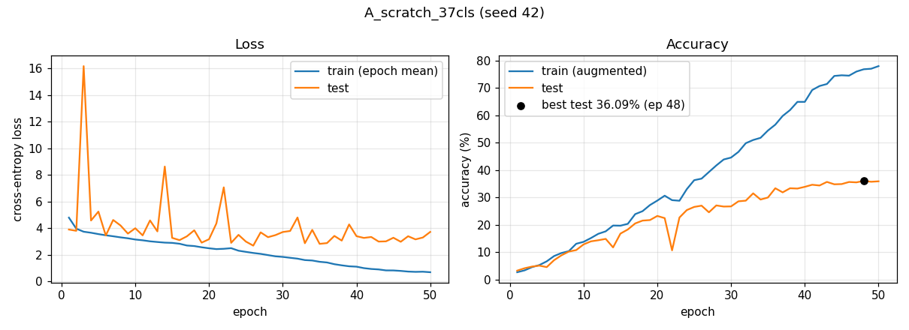
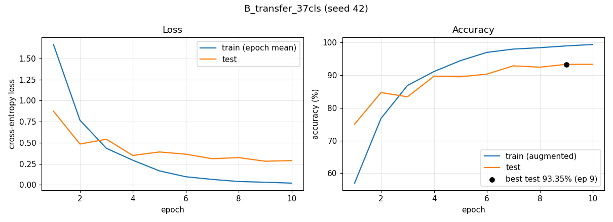
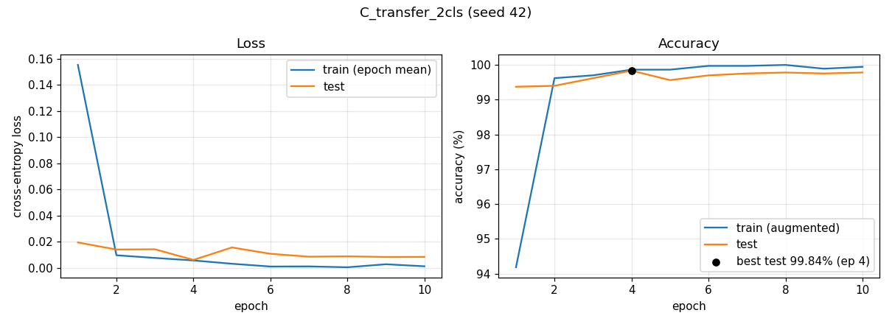

# Results summary (re-run 2026-11-13)

All numbers below come from the runs listed here; each run folder in `results/` holds its `config.json`, `metrics.csv` (one row per epoch), `summary.json` and `train.log`. Raw checkpoints and TensorBoard event files stay local under `runs/` (gitignored).

"Test" is the official `test.txt` split (3669 images). The repo has no separate validation split, so the **best** epoch is selected on the test split and is slightly optimistic; the **final** epoch is the unbiased number.

| Experiment | Epochs | Best test acc (epoch) | Final test acc (epoch) | Final test loss | Train time | Hardware | Seed | Commit | Run |
|---|:-:|:-:|:-:|:-:|:-:|---|:-:|:-:|---|
| A. ResNet-50 from scratch, 37 breeds | 50 | 36.09% (48) | 35.92% (50) | 3.711 | 61.5 min* | RTX 3050 6GB Laptop, torch 2.14.1+cu130 | 42 | `0cfedcf` | [`A_scratch_37cls/`](A_scratch_37cls/) · local `runs/2026-11-13_A_scratch_37cls` |
| B. Pretrained ResNet-50 (IMAGENET1K_V2), 37 breeds | 10 | 93.35% (9) | 93.35% (10) | 0.288 | 5.2 min | same | 42 | `0cfedcf` | [`B_transfer_37cls/`](B_transfer_37cls/) · local `runs/2026-11-13_B_transfer_37cls` |
| C. Pretrained ResNet-50 (IMAGENET1K_V2), cat vs dog | 10 | 99.84% (4) | 99.78% (10) | 0.008 | 4.9 min | same | 42 | `0cfedcf` | [`C_transfer_2cls/`](C_transfer_2cls/) · local `runs/2026-11-13_C_transfer_2cls` |

\* Run A shared the GPU with another training job during epochs 1–6 (148–583 s per epoch). With the GPU free, epochs took about 51–55 s (median over all 50 epochs: 53.5 s), i.e. about 45 min for 50 epochs.

Checkpoints: `best_model.pth` = best epoch above, `last_model.pth` = final epoch (both in `runs/<run>/checkpoints/`).

## Other metrics

| Experiment | Lowest test loss (epoch) | Final train acc (augmented) |
|---|:-:|:-:|
| A | 2.679 (26) | 77.96% |
| B | 0.280 (9) | 99.43% |
| C | 0.006 (4) | 99.95% |

## Curves

## Confusion matrices (test split, final epoch, exported from TensorBoard)

- [A. From scratch, 37 breeds](A_scratch_37cls_confusion_matrix.png)
- [B. Transfer learning, 37 breeds](B_transfer_37cls_confusion_matrix.png)
- [C. Transfer learning, cat vs dog](C_transfer_2cls_confusion_matrix.png)

## Notes

- Single seed (42). cuDNN is not forced deterministic, so a re-run on GPU will not be bit-identical; from-scratch accuracy moved 1–2 points between consecutive epochs, so treat differences of that size as noise.
- Run A shows clear overfitting (train 78% vs test 36%) and noisy test loss with spikes at epochs 3, 14 and 22 while the learning rate was high.
- View the TensorBoard logs (scalars and per-epoch confusion matrices) with `uv run tensorboard --logdir runs/`.
